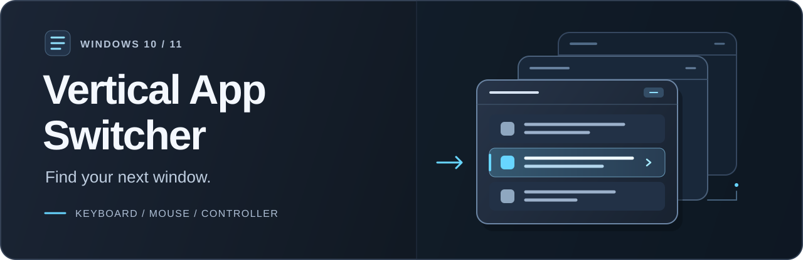
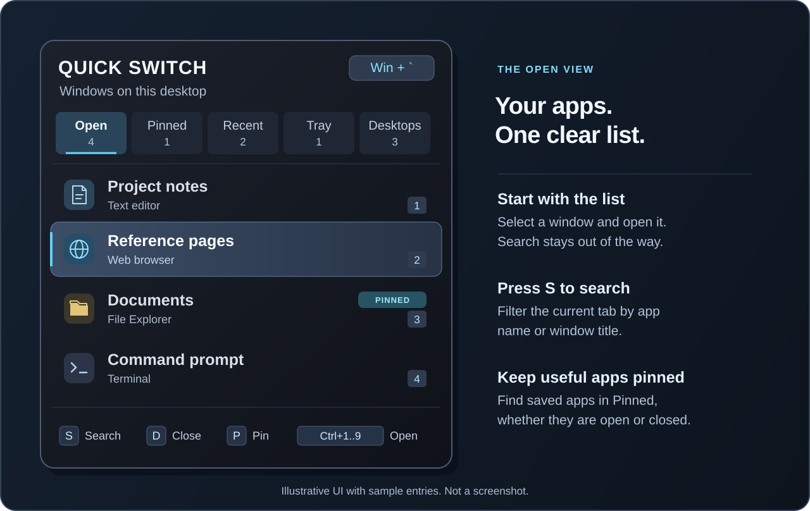

<p align="center">
  
</p>

<p align="center">
  <strong>A vertical app list for Windows desktops and handheld PCs.</strong><br>
  Switch windows with a keyboard, mouse, or Xbox/XInput controller.
</p>

<p align="center">
  
  <a href="https://dotnet.microsoft.com/download/dotnet/10.0"></a>
  
  
  <a href="https://github.com/ness001/vertical-app-switcher/stargazers"></a>
</p>

<p align="center">
  <a href="#features">Features</a> ·
  <a href="#quick-start">Quick start</a> ·
  <a href="#controls">Controls</a> ·
  <a href="#search">Search</a> ·
  <a href="#more-details">More details</a> ·
  <a href="#documentation">Documentation</a> ·
  <a href="#star-history">Star history</a>
</p>

## Features

One overlay brings together open windows, saved apps, recently closed apps,
notification-area apps, and other virtual desktops. Choose a global shortcut,
find an app, and switch to it without reaching for the taskbar.

<p align="center">
  <br>
  <sub>Illustrative UI with sample entries, not a screenshot.</sub>
</p>

The five tabs appear in this order:

| Tab | What it shows |
| --- | --- |
| **Open** | Windows on the current desktop, including minimized windows. Recorded foreground use keeps them in recent-use order. |
| **Pinned** | Saved apps in any state: open, closed, in the tray, or on another desktop. Pins stay saved across restarts. |
| **Recent** | Up to 12 recently closed desktop apps and File Explorer folders that can be reopened. |
| **Tray** | Running notification-area apps, including hidden overflow icons, without duplicate visible-window entries. |
| **Desktops** | Windows on other virtual desktops. Opening a row switches to that desktop. |

- **Find an app:** search the current tab by window title or app name.
- **Choose your input:** use keyboard, mouse, mouse wheel, or Xbox/XInput controls.
- **Keep the app available:** it runs in the notification area, with optional
  **Start with Windows**.

The app uses C#, Windows Forms, and native Windows APIs. It targets
`net10.0-windows` (.NET 10 LTS), with no NuGet packages or third-party runtime
dependencies.

## Quick start

### Build from source

1. Use Windows 10 or 11 and install the
   [.NET 10 SDK](https://dotnet.microsoft.com/download/dotnet/10.0).
2. Clone or download this source repository. Open **Windows PowerShell** in
   the repository folder.
3. Build and launch:

```powershell
powershell.exe -NoProfile -ExecutionPolicy Bypass -File .\Build.ps1
.\VerticalAppSwitcher.exe
```

The build creates `VerticalAppSwitcher.exe` in the repository folder. It is a
framework-dependent, single-file executable for **Windows x64** by default.
The PC that runs it needs the matching
[.NET 10 Desktop Runtime](https://dotnet.microsoft.com/download/dotnet/10.0).
**Administrator access is not required.** You can also double-click the built
executable in File Explorer.

<details>
<summary><strong>Build for Windows on Arm</strong></summary>

```powershell
powershell.exe -NoProfile -ExecutionPolicy Bypass -File .\Build.ps1 `
    -RuntimeIdentifier win-arm64
```

Use the matching Arm64 .NET 10 Desktop Runtime on the target PC.

</details>

If the switcher is running, `Build.ps1` requests a normal shutdown before it
replaces the executable, then restarts it in background mode. It identifies
the running executable by its full path. If shutdown fails, replacement stops;
use the switcher's tray-menu **Exit** command instead of force-stopping it.
If the app was not running, the build does not start it.

### Choose a shortcut

First-run setup lets you choose and check a global shortcut. The default is
**Win + Backtick**. Use a preset, the on-screen keyboard, or **Record keys**,
then select **Save shortcut**. A conflict is shown before the shortcut is saved.

After setup, the app bar opens. Use the shortcut to open or dismiss it. When you
dismiss the bar, the app stays in the notification area. Launching the
executable again opens the existing app bar; it does not start a second copy.

### Optional: start with Windows

Right-click the switcher's notification-area icon and select **Start with
Windows**. Automatic startup uses background mode. To start in that mode
manually:

```powershell
.\VerticalAppSwitcher.exe --background
```

With no running instance, this starts quietly in the notification area. First-run
setup or a shortcut conflict can still show setup. With an instance already
running, it asks that instance to show the app bar.

## Controls

These keyboard commands apply while the **app list has focus**. Search has
separate [input rules](#search).

| Action | Keyboard or mouse | Xbox/XInput controller |
| --- | --- | --- |
| Open or dismiss the overlay | Configured global shortcut | — |
| Change tab | `Left` / `Right`, or click a tab | D-pad or left stick Left/Right |
| Select an app | `Up` / `Down`, `Tab`, or mouse wheel | D-pad or left stick Up/Down |
| Select first or last app | `Home` / `End` | — |
| Open, switch, or reopen | `Enter`, `Space`, or click a row | `A` |
| Open a numbered result | `Ctrl + 1` through `Ctrl + 9` | — |
| Show and focus search | `S`; click the field after it is shown | — |
| Pin or unpin | `P` | `Y` |
| Close a live window, or remove a closed Recent entry | `D` | `X` |
| Remove a closed Recent entry | `Delete` is also available | `X` |
| Dismiss the overlay | `Escape` or the invocation shortcut | `B` |

**Close and Remove are different actions.** `D` and `X` request a normal close
for a live window, or remove its Recent entry if the app is already closed.
Removing a Recent entry keeps any saved pin. The footer shows **Close** or
**Remove** for the selected row.

`D` is the only keyboard close command. `C` has no close action. `Delete` never
closes an app. None of these keys or controller buttons requests force-stop.

Right-click a row for open/switch, pin, normal close, force-stop, and
recent-removal actions. **Force-stop is a separate menu action.** It can discard
unsaved work and runs only after you select **Yes** in its warning.

The footer starts with keyboard hints. A controller action shows gamepad hints;
a keyboard or mouse action restores keyboard hints. Only one set is shown at a
time. Both input methods remain available. Right-click the notification-area
icon for startup settings or **Exit**; double-click it to open the overlay.

## Search

Search is a **keyboard and mouse feature**. There is no controller search binding.

1. Press `S` while browsing. The hidden search field appears and receives
   focus. This first `S` is not added to the query.
2. Type part of a window title or app/process name. Matching ignores letter
   case and keeps the tab's existing order.
3. Press `Up` or `Down` once to move focus to the **current match without
   skipping it**. Further arrow presses move through the list.
4. Press `Enter` to open the selected app. Press `S` to return to search.

`Enter` also opens the current match directly from search. `Ctrl + 1` through
`Ctrl + 9` works from search or the list. These shortcuts target the **first nine
entries in the filtered list**, not the first visible rows after scrolling.
Their number labels do not change when you scroll.

The query stays when you change tabs. Clearing it restores the full tab list.
Search stays visible after focus leaves the field. Opening the overlay again
clears the query and hides search, with no empty search space above the list.

<details>
<summary><strong>Search keys, focus, and empty results</strong></summary>

- While search has focus, letters such as `D`, `P`, and `S` are text, not app
  commands. `Left`, `Right`, `Home`, `End`, and `Delete` keep their text-editing
  actions.
- Use `Ctrl + A`, then `Backspace` or `Delete`, to clear the query. There is no
  separate clear button.
- `Tab` or `Shift + Tab` returns focus to the list without clearing the query.
  Clicking a tab or using the controller also returns to list controls. Click
  the visible search field to continue typing.
- App rows have no selection highlight while search has focus. The highlight
  appears when focus moves to the list. Browsing commands such as `D` and `P`
  then apply to that selected row.
- A query change keeps the selected row if it still matches; otherwise, it
  selects the first match. Tab counts show the number of matching entries.
- With no matches, the list shows **No matching apps** and **Change or clear
  the search to see more apps.** `Up` and `Down` keep focus in search, and
  `Enter` does not open another app.

</details>

## More details

<details>
<summary><strong>Shortcut setup</strong></summary>

The on-screen keyboard uses a US-layout guide. Click Ctrl, Alt, or Win and one
other key for a two-key shortcut such as **Ctrl + K**. Click a selected key again
to clear it, or select **Clear selection** to start over. Shift can be added,
but it cannot be the only modifier. You can also choose a preset or use
**Record keys** while the setup page has focus.

The page checks whether Windows can reserve the combination. If it is not
available, choose another or select **Check again**. **Save shortcut** checks
again before applying it. A registration check cannot detect shortcuts used
only inside another app.

To change the shortcut later, click the shortcut chip at the top-right of the
app bar or choose **Set up shortcut...** in the notification-area menu. If
another program takes the saved shortcut, setup opens so you can choose a
working alternative. With the default shortcut, **Win + Shift + Backtick** is
also available as a layout-compatible alias.

</details>

<details>
<summary><strong>List order, selection, and pins</strong></summary>

**Open** uses foreground-use history recorded during the current switcher
session, not usage frequency. Windows with recorded use appear first. Minimized
windows keep their recent-use position instead of moving to the bottom.
Windows without that history follow in Windows discovery order (Z-order).
History is not saved across switcher restarts. If tracking is unavailable,
all Open rows use discovery order.

When the overlay opens, it selects the entry **after the foreground window in
Open** if that window is listed. Otherwise, it selects the first available
entry. This is not a separate "previously used app" selection rule. If Open is
empty, the first nonempty tab opens. Each tab keeps its selection and scroll
position while you change tabs.

**Pinned** is a filter across app states. It includes pinned open windows, tray
apps, recent apps, other-desktop windows, and saved apps that are not running.
Entries also remain in their matching tab. Pinning adds a badge and saves the
app; it does **not** give the app sorting priority in another tab. Pinned uses
saved pin order. Tray, Desktops, and Recent keep their own order rules.

Search filters these lists without changing their base order or saved history.

</details>

<details>
<summary><strong>Recently closed apps and live updates</strong></summary>

Recent keeps up to **12** relaunchable desktop-app identities. File Explorer
folders are tracked individually, even while other Explorer windows remain
open. Reopening an Explorer entry restores its original folder path.

When an app quits while the overlay is visible, the list updates after the next
tracker check, normally within 100 ms. A relaunchable app moves to Recent; a
duplicate or non-relaunchable row is removed. A window that continues as a
tray app moves to Tray. Any saved pin remains in Pinned.

The current tab and search query stay in place. If the selected row leaves the
filtered list, selection moves to the nearest remaining match. If no matches
remain, the current tab stays selected and empty. You do not need to reopen
the overlay to see these changes.

The tracker also records displayed windows before a normal-close or force-stop
request, so a quick exit can appear in Recent. An app that opens and closes
entirely between checks cannot be recovered. Removing a closed Recent entry
does not remove its pin. A saved offline pin with no Recent entry is unchanged
by the close/remove keys.

</details>

<details>
<summary><strong>Tray apps and platform limits</strong></summary>

Tray includes registered notification-area apps and hidden overflow icons.
Apps with a visible window are shown only once. Activation uses the registered
executable or packaged-app identity, including Windows apps such as Xbox App.
A single-instance app can then show its existing window.

Tray activation is best-effort: it does not simulate a click on a tray icon.
An app that ignores a repeat launch can remain hidden. A tray-only row has no
window handle (HWND), so it cannot receive a normal close request. The switcher
reports that limit and does not request force-stop instead.

- **Windows only:** macOS needs a separate port and is not supported.
- **Shared controller input:** a foreground game can receive the same XInput
  actions as the overlay; the switcher does not capture the controller
  exclusively.
- **Display scaling:** the app is system-DPI aware, not Per-Monitor-V2 aware.
  Monitors with different scale factors can require further support.
- **Local operation:** the app makes no network requests and does not elevate
  itself. Saved state and diagnostics stay in the current user's local app data.

</details>

<details>
<summary><strong>Local files and diagnostics</strong></summary>

| File | Contents |
| --- | --- |
| `%LOCALAPPDATA%\VerticalAppSwitcher\state.json` | Pins and recent history. |
| `%LOCALAPPDATA%\VerticalAppSwitcher\settings.json` | Selected shortcut and first-run setup state. |
| `%LOCALAPPDATA%\VerticalAppSwitcher\switcher.log` | Runtime diagnostics and errors. |

The log includes app start/stop, shortcut registration, controller actions,
recent-history updates, and input, activation, persistence, and cleanup errors.
Recoverable failures can also appear as a tray notification; fatal startup
errors show a message box.

The framework-dependent build uses the installed .NET runtime. This keeps the
executable small and lets installed .NET security and servicing updates apply
without republishing the app.

</details>

## Documentation

| Guide | Use it for |
| --- | --- |
| [Design and architecture](./DESIGN.md) | Current behavior, components, Windows APIs, state, and known limits. |
| [UI testing](./docs/UI-TESTING.md) | Focused checks, safe test data, app lifecycle, and evidence requirements. |

## Star history

The chart shows public GitHub stars over time. It can be empty until the first
star. [View the stargazers](https://github.com/ness001/vertical-app-switcher/stargazers)
if the chart does not load.

<p align="center">
  <a href="https://www.star-history.com/#ness001/vertical-app-switcher&amp;Date">
    <picture>
      <source media="(prefers-color-scheme: dark)" srcset="https://api.star-history.com/svg?repos=ness001/vertical-app-switcher&amp;type=date&amp;theme=dark">
      <source media="(prefers-color-scheme: light)" srcset="https://api.star-history.com/svg?repos=ness001/vertical-app-switcher&amp;type=date">
      
    </picture>
  </a>
</p>
