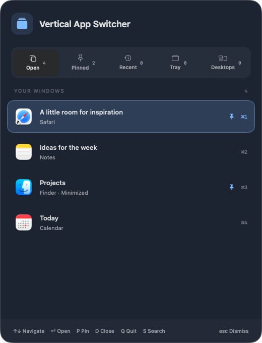

# Native macOS version

An independently written Swift app using AppKit for its menu-bar lifecycle,
nonactivating panel, and window integration, with SwiftUI for the overlay.
Requires macOS 13 or newer, on Apple Silicon or Intel. No .NET runtime or
external packages are needed. Controller/XInput support is intentionally omitted.
Windows source remains separate.

## Install from a release

The universal ZIP runs on Apple Silicon and Intel without developer tools.

1. Download `VerticalAppSwitcher-<version>-osx-universal.zip` from
   [GitHub Releases](https://github.com/ness001/vertical-app-switcher/releases).
2. Extract it and move **Vertical App Switcher.app** to **Applications**.
3. Open the app and enable that bundle in **System Settings → Privacy &
   Security → Accessibility**.
4. Choose and save a shortcut. The default is **Control–Backtick (`)**.

Screen Recording and Input Monitoring are not required. Packages are not
notarized; follow your organization's security policy if macOS blocks opening
the app. A checksum verifies integrity, not publisher identity.



*Captured from the real app in isolated demo mode with sample entries.*

## Build from source

```bash
bash macos/build.sh
open 'bin/macos/Vertical App Switcher.app'
```

Builds refuse to replace a running output app and never stop another process.
A matching Apple SDK/compiler is required. If the default SDK is newer than the
compiler, select a compatible installed SDK with `SDKROOT`:

```bash
SDKROOT=/Library/Developer/CommandLineTools/SDKs/MacOSX26.5.sdk ARCH=universal bash macos/build.sh
```

To create a versioned universal ZIP and SHA-256 file in `bin/release-macos`:

```bash
VERSION=0.2.0 bash macos/package.sh
```

Packaging uses an isolated temporary build, leaving a running development app
untouched. Assets are `VerticalAppSwitcher-<version>-osx-universal.zip` and
`.zip.sha256`; the ZIP contains only `Vertical App Switcher.app`, including
LICENSE and NOTICE under Contents/Resources. Release CI packages both Windows
architectures and macOS under one version before publication.

Local builds automatically use the persistent `Vertical App Switcher Local Development`
Keychain identity when installed; otherwise they fall back to ad-hoc signing.
Keep that identity to preserve Accessibility approval across rebuilds. Switching
from an old ad-hoc build requires one final reapproval. Builds are NOT notarized. Optional
`CODE_SIGN_IDENTITY='Developer ID Application: …'` enables Developer ID signing;
notarization still needs a separate distribution step. A checksum checks
integrity, not publisher identity. Follow organizational security policy.

## Permissions and startup

Enable this exact bundle in **System Settings → Privacy & Security →
Accessibility**. Screen Recording and Input Monitoring are not required.
Rebuilding an ad-hoc app changes its signature: an old enabled permission can
be stale. Remove/re-add the app in Accessibility and restart if necessary;
no permission is granted automatically.

Use the menu-bar menu to show the overlay, set up a shortcut, change launch at
login, check for updates, or quit. Login registration uses macOS ServiceManagement;
use a stable installed location. `--background` starts quietly, while
`--shutdown` requests normal exit of the single instance. Launching a second
copy signals the existing instance to show, rather than registering duplicate
shortcuts. Demo mode is isolated and excluded from single-instance signaling.

## Tabs and platform adaptations

| Tab | Behavior |
| --- | --- |
| Open | Accessible standard/dialog windows, including minimized and hidden windows. Observed foreground focus determines recent-use order. |
| Pinned | Saved apps across open/background/offline states, in pin order. Offline pins relaunch their bundle. |
| Recent | Up to 12 deduplicated closed-app/document/folder identities. Restores a file/folder when the app exposes its file URL, otherwise relaunches the app. Pins remain independent. |
| Tray | Actual detected menu-bar app owners, including hidden items exposed through Accessibility, deduplicated against live windows. Reopening is best-effort; arbitrary background processes are excluded. |
| Desktops | Windows whose actual managed-Space membership is outside the current desktop. Activation switches to the destination Space before raising/restoring its window. |

Spaces integration dynamically resolves private SkyLight/CGS interfaces and the
AX window-ID bridge. Minimized/hidden windows are not classified from visibility;
unknown membership remains in Open. Missing/changed private APIs degrade to
ordinary Accessibility activation. Future macOS compatibility is not guaranteed.
Menu-bar discovery uses AXExtrasMenuBar ownership or status-level WindowServer
metadata with menu-bar geometry checks. Hosted/custom items or items removed
entirely from Accessibility/WindowServer may be unavailable; no background-app
heuristic is substituted. No AltTab code/assets/dependencies were copied.

Document restoration depends on AXDocument/AXURL exposing a local file URL.
It does not recreate arbitrary unsaved document state or application sessions.
Temporary AX failures are not treated as closures. Refresh is approximately
400 ms plus Accessibility query time, with foreground notification updates;
apps that open and disappear entirely between checks cannot be recovered.

## Keyboard and mouse

- Default global shortcut: **Control–Backtick (`)**. Presets or **Set up
  shortcut…** allow a clickable keyboard guide, recording a custom modified chord, clearing, checking, and
  saving with another availability check. Reserved/system conflicts are rejected;
  application-local shortcuts cannot all be detected. No global key recording.
- Arrow keys navigate; Left/Right change tabs. Enter/Space/click switches or
  launches. Command–1…9 selects the first nine filtered results.
- **S** or **Command–F** reveals/focuses search. Letters are text while editing;
  Up/Down returns to the current selection without skipping. Search persists
  across tabs but clears/hides when reopening. Counts reflect matching results.
- **P** pins/unpins; **D** requests a normal window close, or removes a closed
  Recent entry. **Q** requests normal quit of the selected running app, not the
  switcher; save/confirmation prompts remain under that app’s control. Delete
  only removes closed Recent entries. Repeated keys never force quit. Escape
  dismisses. Mouse wheel changes the selected row.
- Right-click offers switching, pinning, normal close and a separate **Force
  quit app…** action. Force quit affects all app windows, warns of unsaved work,
  and defaults to Cancel. App-only rows cannot receive window close.

The panel follows the pointer's screen, scales with available vertical space,
and respects Reduce Motion. Choose **Appearance → System, Light, Dark, or
Midnight** in the menu-bar menu. System follows macOS; the other presets apply
immediately and persist across restarts.

## Updates and local data

Stable GitHub Releases are checked shortly after startup and every 12 hours.
The menu offers manual checking and automatic-check preference. Compatible
packages are downloaded and SHA-256 verified before an **Update and restart**
confirmation; **Later** postpones reminders for one day. No installation occurs
without confirmation. A helper validates bundle/version/architecture/signature,
requires normal app exit, backs up/replaces only the bundle, and restarts.
Failures preserve or restore the old bundle; uncertain running restarts are
not forcibly terminated or overwritten. No elevation is attempted. A writable
installed location is required. Ad-hoc updates may require Accessibility approval
again. A Developer ID signing/notarization deployment remains separate work.

User data lives under `~/Library/Application Support/VerticalAppSwitcher/`:
`state.json` stores pins/recent identities/shortcut/appearance; `switcher.log` is bounded
runtime diagnostics; `Updates/` contains staging and helper logs. Update
preferences use the app's UserDefaults domain. Update checks contact GitHub;
window titles, pins, and history are not sent. Window/document history can
contain local names/paths. Old core settings migrate without resetting pins.

## Focused verification

```bash
swift test --package-path macos
xcrun swiftc macos/Sources/VerticalAppSwitcher/Updates.swift \
  macos/Sources/VerticalAppSwitcher/UpdatesInstaller.swift \
  macos/Tests/UpdateChecks.swift -o /tmp/update-checks
/tmp/update-checks
```

With working swiftc but broken SwiftPM/XCTest, standalone state/model checks:

```bash
xcrun swiftc -sdk "$SDKROOT" -target "$(uname -m)-apple-macosx13.0" \
  macos/Sources/VerticalAppSwitcher/{Appearance,State,GlobalShortcut,WindowCatalog,MacSpaces,MenuBarAppCatalog,ClosedWindowTracker,WindowFocusObserver,DiagnosticLog,SwitcherModel}.swift \
  macos/Tests/SmokeChecks.swift -o /tmp/vertical-switcher-smoke
/tmp/vertical-switcher-smoke
```

`--demo` uses fixtures and no saved-state mutation, real activation/close,
shortcut registration, login changes, or update requests. Live activation/close
checks need disposable windows with no unsaved work. Never close user windows
as test targets or grant permissions/change login registration for testing.
Build/offline checks do not prove physical keyboard delivery, actual update
installation/rollback, multi-display/full-screen/Spaces behavior or live Finder
restoration; report those separately.
